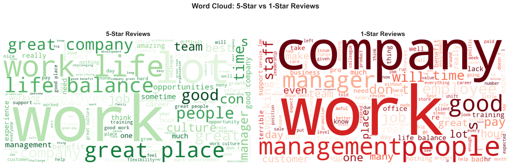
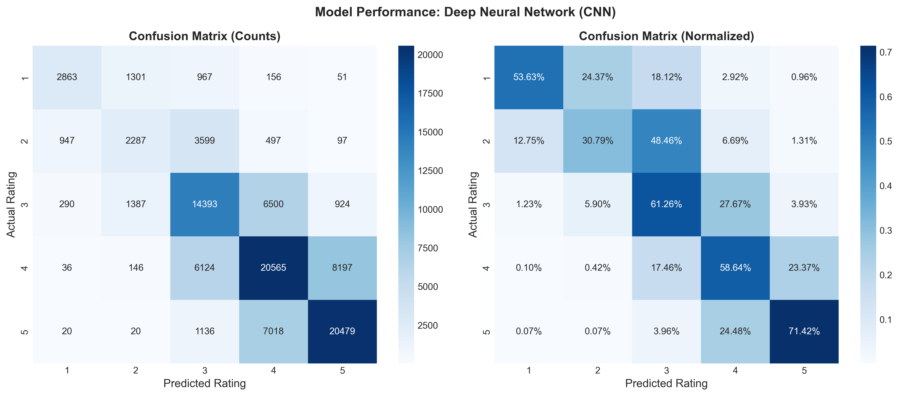
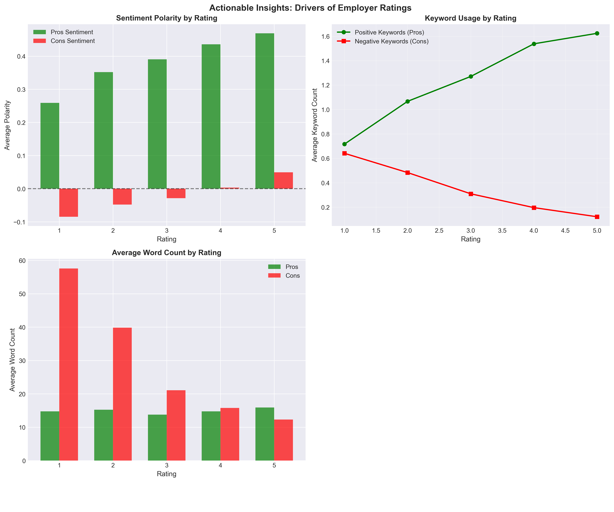
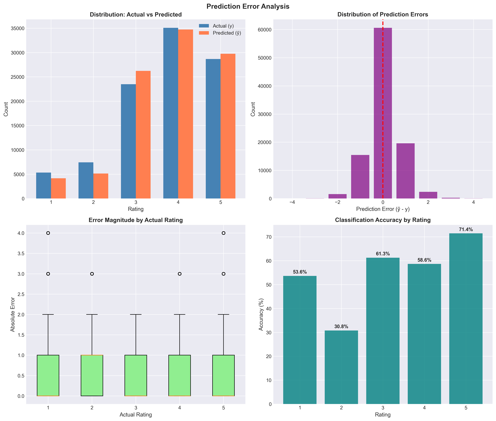

# Glassdoor Review Rating Prediction

Can you predict how many stars an employee gave their employer just from what they wrote? This project trains a hybrid convolutional neural network on 100,000 Glassdoor reviews to predict the star rating (1–5) from the review's pros, cons and headline, then uses the results to identify what separates highly rated employers from poorly rated ones.

Built for the final prediction competition in ECON 424: Machine Learning for Economists, University of Waterloo (Fall 2025). **Ranked 12th of 65 students** on the class leaderboard, scored on a held-out test set of 100,000 reviews.



## Results

| Metric | Value |
|---|---|
| Leaderboard rank | 12 / 65 |
| Accuracy, 5 classes (training data) | 60.6% |
| Baseline: always predict the most common rating (4★) | 35.1% |
| Predictions within one star of the actual rating | 95.7% |
| Best-predicted class | 5★ (71.4% correct) |
| Hardest class | 2★ (30.8% correct; 48% predicted as 3★) |

Most errors are off by one star: the model rarely confuses a 1★ review with a 5★ one, but struggles to separate neighbouring ratings, especially 2★ from 3★.



## What drives ratings



- **Cons length is the strongest length signal, not pros length.** 1★ reviewers write about 58 words of cons on average, versus about 12 for 5★ reviewers. Pros length stays flat at roughly 14–16 words across every rating.
- **Tone rises steadily with rating.** Average sentiment in the pros section climbs from about 0.26 (1★) to 0.47 (5★), and the cons section moves from negative to slightly positive.
- **Keyword use moves in opposite directions.** Positive keywords in pros more than double from 1★ to 5★, while negative keywords in cons fall by about 80%.
- **Vocabulary differs by rating.** 5★ reviews centre on "work-life balance", "great place", "people", "culture" and "opportunities"; 1★ reviews centre on "management", "manager", "staff", "pay" and "hours".

**For employers:** the reviews that drag ratings down are long, detailed complaints, most often about management, pay and hours. Those are the areas where intervention is most likely to show up in ratings.

**Correlation, not causation.** These are associations in review text. Happier employees may simply write differently (reverse causality), unobserved factors like industry or location affect both text and rating, and the people who choose to post reviews are not a random sample.

## Method

1. **Text cleaning:** lowercased, stripped non-letters, combined pros, cons and headline.
2. **Feature engineering (60+ features):**
   - TF-IDF on pros, cons and headline (unigrams and bigrams, up to 2,800 terms)
   - Length, word count, vocabulary richness and pros/cons ratios
   - Sentiment polarity and subjectivity (TextBlob)
   - Readability (Flesch score, syllables, words per sentence)
   - Punctuation, capitalisation and number patterns
   - Positive and negative workplace keyword counts
   - Firm encoding and review year
3. **Model:** a two-branch neural network in TensorFlow/Keras.
   - Text branch: word embeddings → parallel 1D convolutions (3, 4 and 5-word windows) → max pooling
   - Feature branch: dense layers on the scaled engineered features
   - Merged dense layers with dropout and batch normalisation → softmax over 5 ratings
   - Early stopping and learning-rate reduction on a 15% validation split
4. **Ensemble attempt:** XGBoost and LightGBM on the sparse feature matrix were built but disabled in the final run because they exceeded available memory; the submitted predictions come from the CNN alone.



## Repo structure

```
├── data/
│   └── README.md                     # dataset description (data not included)
├── figures/                          # charts produced by the script
├── src/
│   └── glassdoor_rating_cnn.py       # full pipeline: features, model, figures
└── requirements.txt
```

## Run it

```bash
pip install -r requirements.txt
python -m textblob.download_corpora
# place small_train.csv and test_without_response_v1.csv in data/
python src/glassdoor_rating_cnn.py
```

## Limitations

- **Accuracy above is measured on training data.** The leaderboard rank reflects performance on the held-out test set.
- **Training covered the 100K small dataset only.** The 500K large dataset was available but exceeded memory on a laptop.
- **Distribution shift.** Test reviews skew older (2008–2016) while training reviews skew newer (2019–2021). See `figures/fig2_train_test_distribution.png`.
- **Ordinal target treated as categories.** The model doesn't know 4★ is closer to 5★ than to 1★; an ordinal loss could reduce the 2★/3★ confusion.

## Use of AI

AI tools were encouraged in this course. I used Claude as a coding assistant to help write and debug the Python. I set the modelling approach, chose the features, ran and tuned the experiments (including working around memory limits on the 500K dataset), selected the final model, and interpreted the results and their business implications.

## Author

Abdisami · [LinkedIn](https://linkedin.com/in/abdisami)
